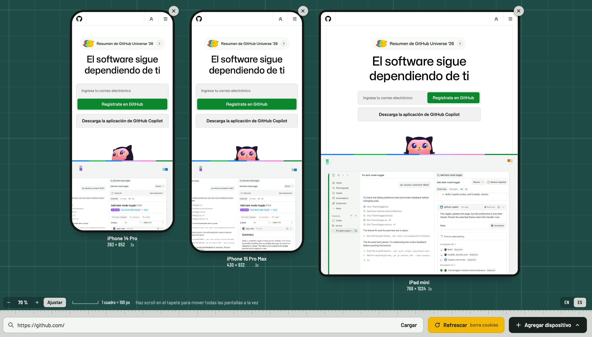

# Responsive Viewer

See a page on several devices at once — iPhone, Android, tablets and desktop, side by side. Free and open source, built with Flask.



- **Search bar**: type a URL and press Enter. Each screen requests the page with its device's User-Agent.
- **Refresh**: reloads every screen and **clears all their cookies**. Use it instead of Cmd + R.
- **Add device**: opens the device list; check or uncheck the ones you want. The more screens you add, the lower the zoom, so they all fit. Each screen has an ✕ to remove it.

### Zoom

The viewer has its own zoom, separate from the browser's:

- **− / + / Fit** buttons in the bottom-left corner. **Fit** (the default) sizes the screens so they all fit.
- **⌘ + / ⌘ − / ⌘ 0** (Ctrl on Windows and Linux) zoom the screens instead of the browser page.
- **Pinch on a trackpad or Ctrl + scroll wheel** zooms toward the pointer, even over a screen.
- When the screens don't fit, drag the mat's background to move around it (or use its scrollbars).

### Scrolling

- **Scroll on the mat** (the green background between and around the screens) to scroll **every screen at once**. Each one keeps its own position, so screens you scrolled on their own stay offset. Hold Shift to scroll sideways.
- **Scroll over a screen** to scroll only that one.

The interface is in English by default; switch to Spanish with the EN / ES toggle in the bottom-right corner.

## Install

The only thing you need is **Python 3.9 or newer**. The installer checks for it and tells you how to get it if it's missing.

First, download this project: on GitHub click **Code → Download ZIP** and unzip it (or `git clone` it).

### macOS and Linux

1. Open **Terminal** (on macOS: press ⌘ Space, type "Terminal", press Enter).
2. Type `bash ` (with a space at the end), drag the `install.sh` file into the Terminal window and press Enter.
3. When it asks "Open it now?", press Enter. Your browser opens with the viewer.

Next time, run `./start.sh` from the project folder (or drag `start.sh` into Terminal and press Enter).

### Windows

1. Double-click **`install.bat`**. If Windows warns that the file came from the internet, choose **More info → Run anyway**.
2. When it asks "Open it now", press **Y**. Your browser opens with the viewer.

Next time, double-click **`start.bat`**.

If you use Git Bash, `bash install.sh` and `./start.sh` work on Windows too.

### What the installer does

It creates a private folder called `.venv` inside the project and installs Flask and requests there. Nothing is installed system-wide, and you can uninstall everything by deleting the project folder.

### Using it

- The viewer opens at <http://127.0.0.1:5050>. If that port is busy, it uses the next free one and prints the address in the terminal.
- Keep the terminal window open while you use it. Press **Ctrl+C** to stop it.
- Options: `--port 8080` to pick a port, `--no-browser` to not open the browser, `--debug` to reload when the code changes (for development).
- You can open a view directly: `http://127.0.0.1:5050/?url=example.com&devices=iphone-se,pixel-7,ipad-mini`

### For developers

```bash
python3 -m venv .venv
source .venv/bin/activate        # Windows: .venv\Scripts\activate
pip install -r requirements.txt
python app.py --debug
```

## How it works

The screens are iframes, but they don't load the site directly. They go through `/proxy`, which:

1. downloads the page with the device's User-Agent,
2. removes the headers that block showing it inside an iframe (`X-Frame-Options`, `Content-Security-Policy`),
3. keeps cookies in a separate jar for each screen, so each screen has its own login,
4. injects a small script (`static/js/frame-inject.js`) so links, forms and `fetch` / `XMLHttpRequest` calls keep going through the proxy.

**Refresh** calls `/api/reset`, which empties those jars and responds with `Clear-Site-Data: "cookies"` so the browser also deletes any cookies the page set with JavaScript.

### Adding devices

Edit `devices.py`. Each device has `width` and `height` (viewport in CSS px), `dpr` and `ua` (User-Agent). `group` is one of `phones`, `tablets` or `desktop`. `DEFAULT_DEVICE_IDS` sets which devices appear the first time.

### Adding a language

Interface strings live in `static/js/i18n.js`. Copy the `en` block, translate it, and add a button with `data-lang="xx"` to the language switch in `templates/index.html`. Error messages shown inside a screen are in `ERRORS` in `app.py`.

## Known limitations

- Pages, links, forms (GET and POST, so logging in works) and the page's `fetch` / `XMLHttpRequest` calls go through the proxy with the device's User-Agent. Images, CSS, scripts and fonts load straight from the site.
- "Sign in with Google / Apple" and other sign-in pages hosted on another company's domain usually won't work inside a screen: those providers block being shown in frames or proxied.
- WebSockets aren't proxied.

## Security

This tool is meant to run **on your own computer**. Don't deploy it to a public server:

- `/proxy` downloads any `http`/`https` URL, including addresses on your local network.
- When you log in to a site inside a screen, your password goes through this local server on its way to the site. Session cookies are kept only in memory and are deleted with **Refresh** or when you stop the viewer.
- Loaded pages run on the same origin as the viewer (the iframe has `allow-scripts` and `allow-same-origin` so cookies and `localStorage` work). Only open sites you trust.

## Project layout

```
install.sh / install.bat    installers (macOS, Linux, Git Bash / Windows)
start.sh / start.bat        start the viewer and open the browser
app.py                      Flask server, proxy and cookie reset
devices.py                  device catalog
templates/index.html        interface
templates/frame_error.html  message shown when a page can't load
static/css/styles.css
static/js/i18n.js           interface strings (English, Spanish)
static/js/app.js            layout, zoom, menu and buttons
```
